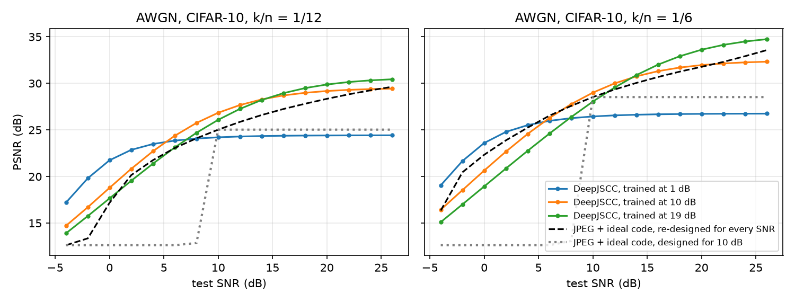
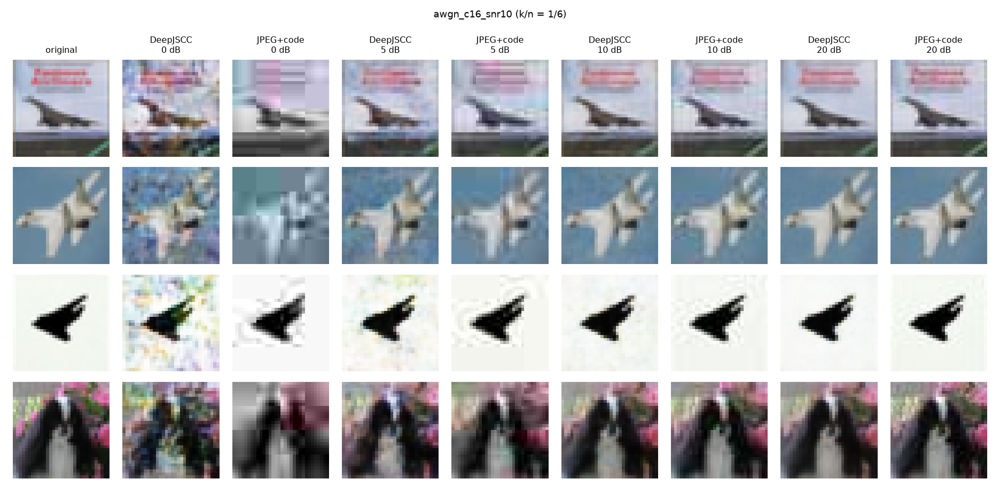
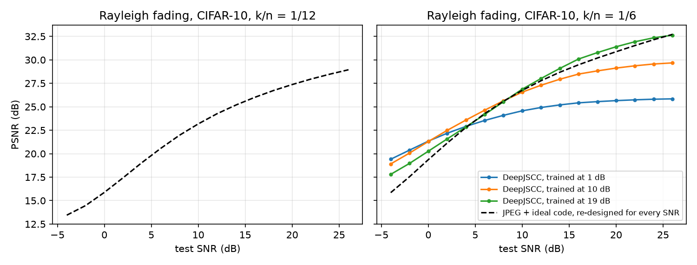
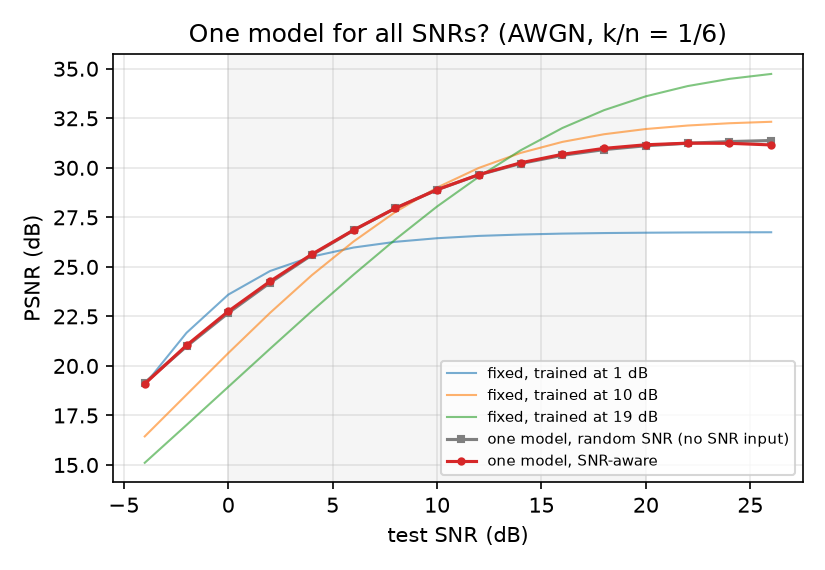
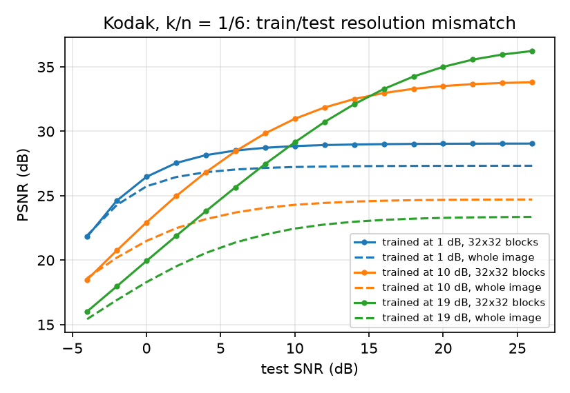
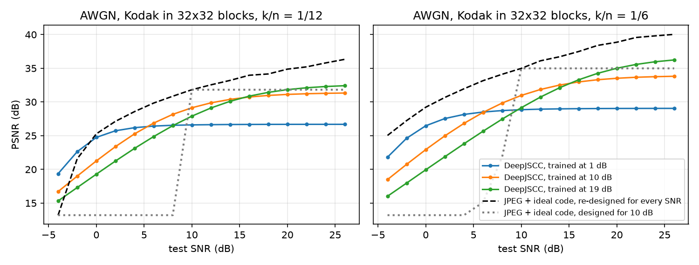

# DeepJSCC from scratch: deep joint source-channel coding for wireless image transmission

A from-scratch PyTorch reimplementation of **Bourtsoulatze, Kurka & Gündüz, "Deep Joint Source-Channel Coding for Wireless Image Transmission" (IEEE TCCN 2019)**. Image compression and error protection are learned as one autoencoder whose bottleneck *is* the noisy wireless channel. It is tested against a deliberately generous separation baseline, JPEG plus a capacity-achieving channel code. The study has five research questions: two reproduce the paper, two extend it (fading, one model for all SNRs), and one is a train/test resolution failure I found and diagnosed.

Everything here was trained and evaluated on a 4 GB laptop GPU (RTX 2050): 11 models, about 2 hours in total.

```
image ─► CNN encoder ─► k complex symbols ─► power normalisation ─► noisy channel ─► CNN decoder ─► image
         (5 conv, PReLU)                       (avg power = 1)        (AWGN / fading)   (5 deconv)
```

## Results at a glance (CIFAR-10 test set, 10,000 images)

| | 0 dB | 4 dB | 10 dB | 16 dB | 20 dB |
|---|---|---|---|---|---|
| **k/n = 1/12** DeepJSCC (best of the 3 fixed-SNR models) | **21.75** | **23.49** | **26.85** | **28.95** | **29.88** |
| JPEG + ideal code, re-designed for every SNR | 17.18 | 21.76 | 25.03 | 27.25 | 28.34 |
| JPEG + ideal code, designed once for 10 dB | 12.63 | 12.63 | 25.03 | 25.03 | 25.03 |
| **k/n = 1/6** DeepJSCC (best of the 3 fixed-SNR models) | **23.60** | **25.52** | **29.01** | **32.01** | **33.61** |
| JPEG + ideal code, re-designed for every SNR | 22.34 | 25.25 | 28.53 | 30.68 | 31.77 |
| JPEG + ideal code, designed once for 10 dB | 12.63 | 12.63 | 28.53 | 28.53 | 28.53 |

PSNR in dB, AWGN channel. k/n is the number of complex channel symbols per pixel value. All numbers are in [results/summary.md](results/summary.md), and every curve at 16 test SNRs is in [results/eval.json](results/eval.json).





*Model trained at 10 dB, k/n = 1/6. At 0 dB JPEG can only afford a few blocks of coarse colour; DeepJSCC keeps the shape and adds noise. At 20 dB both are clean.*

## What I found

### RQ1. Graceful degradation instead of a cliff (reproduces the paper)
A separation scheme designed for 10 dB gives 28.5 dB at or above 10 dB. At 8 dB the code can no longer carry the bitstream, so the image is lost (13.1 dB, a flat mean-colour image). The DeepJSCC model trained at 10 dB degrades smoothly instead: 29.0 dB at 10 dB, 27.8 dB at 8 dB, 24.6 dB at 4 dB and 20.7 dB at 0 dB. It also keeps improving above its training SNR (32.0 dB at 20 dB), while the fixed bitstream stays at 28.5 dB.

### RQ2. Beats even an *ideal* separation scheme at small bandwidth (reproduces the paper)
The baseline is generous: it re-chooses the JPEG quality for every SNR, its channel code reaches Shannon capacity exactly, and the JPEG header costs nothing. Even so:
- At **k/n = 1/12**, the best DeepJSCC model wins at **every** SNR from −4 to 26 dB: +4.6 dB at 0 dB, +1.8 dB at 10 dB and +1.5 dB at 20 dB.
- At **k/n = 1/6** it wins at low and high SNR (+1.3 dB at 0 dB, +1.8 dB at 20 dB) and roughly ties between 4 and 8 dB (within 0.3 dB; the ideal code is 0.25 dB ahead at 6 dB).

The paper compares against real codes (LDPC), which need a margin below capacity, so its gaps are larger.

### RQ3. Slow Rayleigh fading (extension)
Each image goes through one random complex gain *h*, as when a phone sits in a radio shadow. The receiver knows *h* and equalises it. The baseline is given each image's fade in advance and picks the JPEG quality to fit it, which DeepJSCC cannot do. DeepJSCC still matches or beats it from −4 to 24 dB: 21.3 vs 19.4 dB at 0 dB, 26.9 vs 26.8 dB at 10 dB, and 31.4 vs 30.9 dB at 20 dB.



### RQ4. One model for every SNR? Telling it the SNR barely helps (extension; a negative result)
Two single models were trained with the SNR drawn uniformly from 0 to 20 dB:
- **Random-SNR training** (the model is not told the SNR) matches or beats the best fixed model from 4 to 10 dB (up to +0.6 dB at 6 dB, between two fixed training points). It loses 0.9 dB at 0 dB and 2.5 dB at 20 dB: one compromise code cannot be both very robust and very detailed.
- **SNR-aware** (the SNR is fed in as an extra constant input channel) changes the result by **at most 0.08 dB** anywhere in the 0 to 20 dB training range.

Why: a constant feature map passed through a convolution only adds `snr × (sum of that kernel's weights)`, the same additive bias at every position away from the border. The network can shift its activations with the SNR but cannot re-weight its features. This is why ADJSCC (Xu et al., 2021) uses attention modules that *multiply* channels by SNR-dependent factors. Trying that is the obvious next step.



### RQ5. Generalising to large images: a failure I had to diagnose
The models were tested on the 24 Kodak images (768×512) without retraining. Sent **whole**, they did badly. The model trained at 19 dB gave only 23.3 dB at 20 dB, *worse* than the model trained at 1 dB. Sent as **independent 32×32 blocks**, each block a packet with its own power budget, the same model gives 35.0 dB. To find out why, I changed one thing at a time ([tools/kodak_diagnosis.py](tools/kodak_diagnosis.py), model trained at 19 dB, AWGN at 20 dB):

| setting | PSNR (dB) |
|---|---|
| whole image in one pass | 23.28 |
| whole image, **no channel noise at all** | 23.39 |
| whole image, power normalised per 32×32 region | 24.37 |
| encoder on 32×32 tiles, decoder on the whole latent | 26.29 |
| encoder on the whole image, decoder on 8×8 latent tiles | 22.13 |
| encoder **and** decoder on 32×32 tiles | **35.01** |

So:
- **Noise is not the cause:** the problem is there with no noise.
- **Power allocation is not the cause:** per-region normalisation recovers only 1 dB.
- **Fixing only one side is not enough:** both the encoder and the decoder must see 32×32 frames.

The encoder's receptive field is **61 px**, larger than a 32 px CIFAR image. In training, every latent value was therefore computed from a window that included the zero-padded image border, and the learned code depends on where the border is. Latents from the interior of a large image never occurred in training. The paper avoided this by training on larger ImageNet images. The Kodak results below use blockwise transmission.



On Kodak, separation is strong. JPEG compresses the whole 768×512 image at once and exploits redundancy across it. With an ideal code it beats 32×32-block DeepJSCC by 2.6 to 4.7 dB at k/n = 1/6, and from 0 dB upwards at k/n = 1/12 (DeepJSCC wins only at −4 and −2 dB). DeepJSCC still clearly beats the realistic version, a scheme designed for one SNR, below that SNR. A fair Kodak comparison would need DeepJSCC trained on large images.



## How to run

```bash
pip install -r requirements.txt          # PyTorch with CUDA, torchvision, numpy, pillow, matplotlib

python run_all.py --data_root data       # trains all 11 models (skips ones already in checkpoints/),
                                         # then evaluate.py --kodak, tools/plot.py, tools/show_examples.py
```

The trained checkpoints (6.7 MB in total) are included, so the evaluation and figures can be reproduced without training:

```bash
python evaluate.py --data_root data --kodak     # all models x 16 test SNRs -> results/eval.json (about 2 min on GPU)
python evaluate.py --data_root data --kodak --baselines_only   # recompute only the JPEG baselines (CPU)
python tools/plot.py                            # figures + results/summary.md
python tools/show_examples.py --data_root data  # results/figures/examples.png
python tools/kodak_diagnosis.py --data_root data  # the RQ5 table
```

One model: `python train.py --c 16 --channel awgn --snr 10` (8 to 15 min on an RTX 2050). Add `--snr_range 0 20 --snr_aware` for the SNR-aware version. CIFAR-10 downloads automatically, and Kodak is downloaded to `<data_root>/kodak` on first use.

## Code map

| file | what it does |
|---|---|
| [jscc/model.py](jscc/model.py) | encoder, decoder, power normalisation, SNR-aware inputs |
| [jscc/channel.py](jscc/channel.py) | AWGN and slow Rayleigh fading (zero-forcing equalisation, perfect receiver CSI) |
| [jscc/baselines.py](jscc/baselines.py) | JPEG + capacity-achieving code: re-designed per SNR, and fixed at a design SNR (cliff) |
| [jscc/data.py](jscc/data.py) | CIFAR-10 held on the GPU as uint8, Kodak loader, PSNR |
| [train.py](train.py) | training: Adam 1e-3, cosine schedule, 120 epochs, batch 64, random flips, MSE loss |
| [evaluate.py](evaluate.py) | every model at 16 test SNRs (−4 to 26 dB), CIFAR-10 and Kodak (blocks and whole) |
| [tools/](tools/) | figures, summary tables, visual examples, the Kodak diagnosis |

## Limitations

- One training seed per configuration; differences under about 0.2 dB should not be read as real.
- The models are trained on 32×32 images only (see RQ5). The baseline uses JPEG; BPG or a learned codec would be stronger.
- Fading assumes perfect channel knowledge at the receiver. No real radio hardware or channel estimation is involved.
- The model is the original small CNN (143k parameters at k/n = 1/12, 156k at 1/6), not a modern transformer-based JSCC.

## References

1. E. Bourtsoulatze, D. B. Kurka, D. Gündüz. *Deep Joint Source-Channel Coding for Wireless Image Transmission.* IEEE TCCN, 2019.
2. J. Xu, B. Ai, W. Chen, A. Yang, P. Sun, M. Rodrigues. *Wireless Image Transmission Using Deep Source Channel Coding With Attention Modules* (ADJSCC). IEEE TCSVT, 2021.
3. D. B. Kurka, D. Gündüz. *DeepJSCC-f: Deep Joint Source-Channel Coding of Images with Feedback.* IEEE JSAIT, 2020.
4. K. Yang et al. *SwinJSCC: Taming Swin Transformer for Deep Joint Source-Channel Coding.* 2023.
